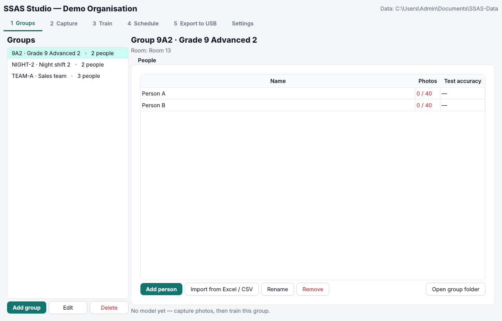
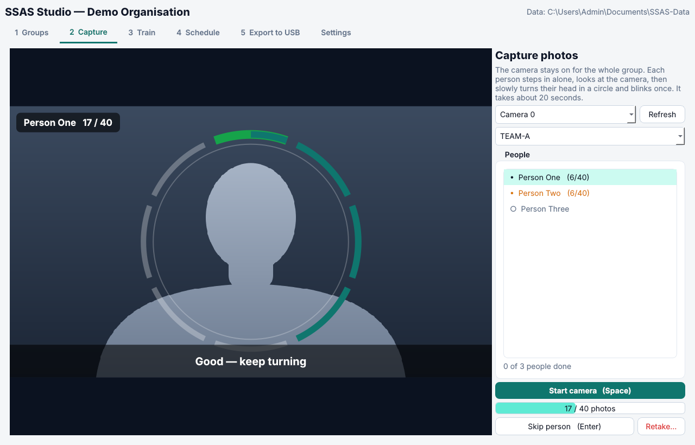
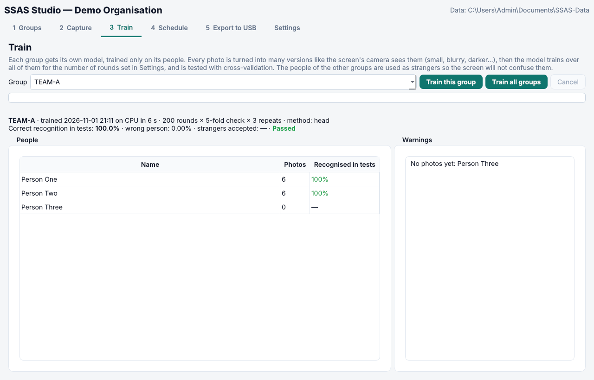
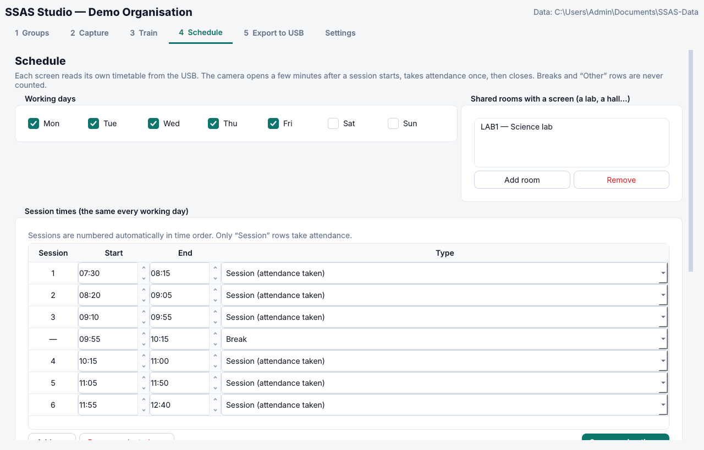
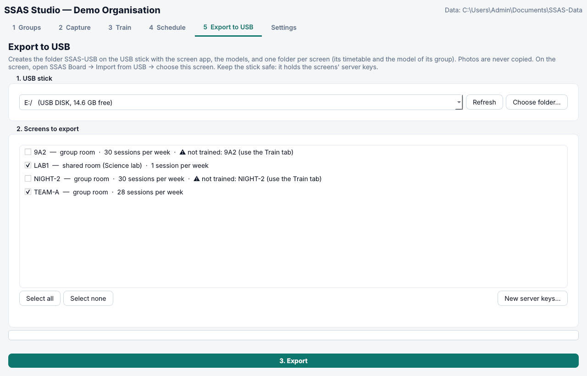

# SSAS بيشتغل إزاي؟ — الشرح الكامل من الصفر

> الملف ده لأي حد جديد. مش محتاج تعرف برمجة ولا ذكاء اصطناعي.
> في الآخر فيه **شنطة الهاكاثون**: الكلام في دقيقة (عربي وإنجليزي)، وسيناريو العرض، وأسئلة لجنة التحكيم وإجاباتها.

---

## 0. الفكرة في 30 ثانية

**SSAS (Seif's Smart Attendance System)** بياخد الحضور **لوحده** في أول كل Session (حصة، محاضرة، وردية، اجتماع…):
- **الكاميرا:** الشاشة الذكية الموجودة أصلاً في المكان بتفتح كاميرتها **3 دقايق** بعد البداية، لمدة **5 دقايق بحد أقصى**.
- **التعرف:** بتتعرف على ناس المجموعة **على الشاشة نفسها**، من غير نت.
- **بعد ما تخلص:**
  - الكاميرا بتقفل.
  - النتيجة (مين حاضر ومين غايب) بتروح للسيرفر **كنص بس**.
- **الصور ما بتخرجش من لابتوب الأدمن أبداً.**

---

## 1. المشكلة والحل

**المشكلة:**
- **الوقت:** الحضور اليدوي بياخد دقايق من كل Session، مع كل مجموعة، كل يوم.
- **الغلط والتلاعب:** حد يرد بدل حد، أو كشف يضيع.
- **الحلول التانية ليها عيوب:**
  - البصمة بتعمل طوابير ومحتاجة لمس.
  - الكروت بتتسلف.
  - الـ QR ممكن يتبعت لحد مش موجود.

**الحل:**
- **من غير أجهزة جديدة:** الشاشات الذكية موجودة أصلاً في الفصول وقاعات الاجتماعات، وفيها كاميرا.
- **SSAS بيحوّل الشاشة لـ "مساعد ذكي" (AI Agent):**
  - **بيشوف:** الكاميرا.
  - **بيفهم:** مين موجود.
  - **بيقرر:** حاضر، أو غائب، أو محتاج مراجعة.
  - **بيتصرف:** يبعت النتيجة ويقفل الكاميرا.
  - **من غير ما حد يلمس حاجة.**
- **والخصوصية من الأول:**
  - الكاميرا بتشتغل **دقايق بس** (مش مراقبة).
  - التعرف **على الشاشة نفسها**.
  - **الصور عمرها ما بتسيب لابتوب الأدمن.**

**مش للمدارس بس:** أي مكان فيه **مجموعات** ليها **مواعيد**:
- مدرسة: المجموعة = فصل.
- شركة: المجموعة = فريق أو قسم.
- مصنع: المجموعة = وردية.
- مركز تدريب: المجموعة = كورس.
- نادي: المجموعة = تمرين.

---

## 2. الكلمات المهمة (هتسمعها كتير)

| الكلمة | المعنى | مثال |
|---|---|---|
| **Organisation** | المكان كله | مدرسة النور، شركة X |
| **Group** | مجموعة ناس بيتاخد حضورها مع بعض | فصل 9A1، فريق المبيعات، وردية الليل |
| **Person / People** | شخص في المجموعة | أحمد، سارة |
| **Session** | ميعاد بيتاخد فيه الحضور | الحصة الأولى 7:30–8:15 |
| **Shared room** | مكان فيه شاشة وبتستخدمه أكتر من مجموعة | معمل، قاعة، صالة |
| **Screen / Board** | الشاشة الذكية (أندرويد) | شاشة Hikvision في الفصل |

---

## 3. التلات برامج، ومين بيستخدم إيه

```
 لابتوب الأدمن (Windows)          فلاشة USB              الشاشة الذكية (Android)           السيرفر (اختياري)
 ─────────────────────           ──────────            ────────────────────────          ─────────────────
 SSAS Studio = Admin App   ───►  SSAS-USB      ───►    SSAS Board = Smart Screen App ──►  SSAS Server
 • تصوير الناس                   • التطبيق              • يفتح الكاميرا أول الـ Session    • يستقبل نص بس
 • تدريب نموذج لكل مجموعة       • النماذج              • يتعرف على الناس بنفسه           • صفحات للأدمن
 • الجدول والإعدادات             • فولدر لكل شاشة       • يبعت النتيجة ويقفل الكاميرا     • تصدير Excel (CSV)
```

| البرنامج | مين بيستخدمه | فين |
|---|---|---|
| **SSAS Studio (Admin App)** | الأدمن أو الـ IT | لابتوب Windows، والأحسن يكون فيه كارت شاشة NVIDIA |
| **SSAS Board (Smart Screen App)** | **محدش.** بيشتغل لوحده | كل شاشة ذكية |
| **SSAS Server** | المشرفين والمديرين | كمبيوتر جوه المكان، أو VPS على النت (Hostinger) |
| **الموقع https://ssas.ae** | أي حد عايز ينزّل البرامج | Hostinger |

**مهم:**
- **من غير سيرفر خالص:** النتايج بتتجمع بالفلاشة من القائمة المخفية في الشاشة.
- **مع سيرفر:** النتايج بتوصل لوحدها.

---

## 4. يوم التجهيز، خطوة بخطوة

1. **نزّل SSAS Studio** من https://ssas.ae وسطّبه على اللابتوب.
2. **أول تشغيل:** بيحمّل نماذج الذكاء الاصطناعي مرة واحدة (حوالي 200 ميجا)، وبيتأكد من بصمة كل ملف (SHA-256).
3. **Groups:** اعمل المجموعات (`9A1`، `TEAM-A`…)، وضيف الأسماء (واحد واحد أو من Excel).
4. **Capture:** صوّر كل شخص (حوالي **20 ثانية** للشخص).
   - **يبص قدامه** الأول.
   - بعدين **يلف راسه في دايرة** (8 أجزاء).
   - **ويرمش مرة.**
   - النتيجة: **40 صورة** للشخص.
   - **ليه اللف والرمشة؟** علشان نتأكد إنه **إنسان حقيقي** مش صورة على موبايل.
5. **Train:** درّب نموذج لكل مجموعة (دقايق لكل مجموعة على كارت الشاشة).
6. **Schedule:** اكتب الأيام، ومواعيد الـ Sessions، وجدول كل مجموعة (مين في مكانه ومين في المعمل).
7. **Settings:**
   - **PIN للشاشات:** 6 أرقام أو أكتر.
   - **عنوان السيرفر:** لو فيه سيرفر.
8. **Export to USB:** هيعمل فولدر `SSAS-USB` على الفلاشة.
9. **على كل شاشة:** سطّب التطبيق من الفلاشة ← **Import from USB** ← اختار اسم الشاشة. (حوالي 10 دقايق)
10. **على السيرفر:** ارفع `boards.json` في صفحة **Boards**.

**خلاص.** من النهارده الشاشات بتاخد الحضور لوحدها.

| Groups | Capture | Train |
|---|---|---|
|  |  |  |

| Schedule | Export to USB |
|---|---|
|  |  |

---

## 5. Session واحدة، دقيقة بدقيقة

مثال: الـ Session بتبدأ **8:00**.

| الوقت | اللي بيحصل |
|---|---|
| 8:00 | الـ Session بدأت. الكاميرا **لسه مقفولة**، علشان الناس يدخلوا ويقعدوا |
| 8:03 | الكاميرا بتفتح، و**صوت خفيف** |
| 8:03:00 → 8:07 | **8 صور** على مسافات: 0، 10، 25، 45، 75، 120، 180، 240 ثانية |
| مع كل صورة | الشاشة بتدوّر على الوشوش والأجسام وتتعرف على الناس |
| أول ما **الكل يتعرف عليه** | بتوقف بدري، ومش بتستنى الـ 5 دقايق |
| بعد آخر صورة | **صوت تاني**، والكاميرا **بتقفل** |
| بعدها بثواني | النتيجة بتتحفظ على الشاشة، وبتتبعت للسيرفر (HTTPS) |
| على السيرفر | بتظهر في صفحة **Today**: ✓ حاضر، ○ غائب، ? مراجعة، ! مفيش بيانات |

**وفي آخر اليوم:** السيرفر بيقارن الـ Sessions. لو شخص كان **حاضر الصبح وغايب بعدها**، بيظهر تنبيه **"Left after being present"**.

---

## 6. الذكاء الاصطناعي، خطوة خطوة بكلام بسيط

### 6.1 لقينا وش؟ (Face detection)
- **الموديل:** **SCRFD** (من InsightFace).
- **بيعمل إيه:** بيدوّر في الصورة على **كل الوشوش**، ويرسم مربع حوالين كل وش.
- **وكمان:** بيحدد **5 نقط** في كل وش: العينين، والمناخير، وطرفين البق.

### 6.2 نعدّل الوش (Alignment)
- **بنستخدم الـ 5 نقط** علشان نلف ونصغّر الوش لحد ما يبقى **صورة 112×112** والعينين في **نفس المكان دايماً**.
- **ليه؟** علشان المقارنة تبقى عادلة، مهما الشخص كان مايل أو قريب أو بعيد.

### 6.3 الوش ← 512 رقم (Embedding)
- **الموديل:** **ArcFace** (شبكة عصبية اسمها ResNet-50).
- **بيعمل إيه:** بياخد الوش ويحوّله لـ **512 رقم**. اعتبرهم **"بصمة الوش"**.
- **نفس الشخص:** في صورتين مختلفتين، بيطلع أرقام **قريبة من بعض**.
- **شخصين مختلفين:** بيطلعوا أرقام **بعيدة**.
- **مهم للخصوصية:** **الـ 512 رقم ما ينفعش يترجعوا صورة.**

### 6.4 قد إيه شبه بعض؟ (Cosine similarity)
- **الفكرة:** كل بصمة عبارة عن **سهم** في مساحة فيها 512 اتجاه. بنقيس **الزاوية** بين السهمين.
- **النتيجة رقم من -1 لـ 1:**
  - قريب من **1**: يبقى غالباً نفس الشخص.
  - قريب من **0**: ملهمش علاقة ببعض.
- **مثال:** أحمد وأحمد = 0.7، وأحمد وعمر = 0.1.

### 6.5 نموذج لكل مجموعة (Group model)
- **إحنا مش بنعمل نموذج واحد لكل الناس.** بنعمل **نموذج صغير لكل مجموعة**.
- **فيه إيه:** **سطر واحد من 512 رقم لكل شخص**، وده "الاتجاه" بتاع وشه.
- **ليه كده أحسن؟**
  - **أسرع وأخف:** الشاشة بتقارن بـ 25 شخص بس، مش بآلاف.
  - **أدق:** كل ما الناس اللي بيتقارنوا ببعض أقل، الغلط أقل.
  - **أأمن:** كل شاشة **تعرف ناس مجموعتها بس**.
- **ليه التدريب على اللابتوب؟**
  - التدريب **تقيل** (آلاف الصور × مئات المرات)، فمحتاج كارت شاشة.
  - لكن **الاستخدام خفيف جداً** على الشاشة: مجرد ضرب 512 رقم في سطر كل شخص.

### 6.6 نخلي صور اللابتوب شبه كاميرا الشاشة (Augmentation)
**المشكلة:** صور اللابتوب **قريبة وواضحة**، لكن كاميرا الشاشة بتشوف الشخص **من آخر المكان: صغير، ومهزوز، وإضاءته وحشة**.

**الحل:** كل صورة بنعمل منها **10 نسخ**، وكل نسخة فيها شوية من دول:
- نصغّرها جداً (زي لما الشخص يبقى بعيد).
- نزغللها.
- نغيّر الإضاءة والألوان.
- نضيف تشويش.
- نضغطها JPEG بجودة وحشة.
- نغطي جزء منها.
- نقلبها يمين وشمال.

**النتيجة:** 40 صورة × 11 = **440 نسخة لكل شخص**. والنموذج بيتعلم يتعرف عليه **حتى في أسوأ الظروف**.

### 6.7 التدريب نفسه (Training)
- **البداية:** لكل شخص، بنبدأ بـ **متوسط** بصمات صوره.
- **التحسين:** بنحسّن الاتجاهات **200 مرة (epochs)** بطريقة اسمها **CosFace**:
  - كل شخص لازم يبقى **أقرب لاتجاهه** من اتجاه أي حد تاني، **بفرق واضح** (margin).
  - **ناس المجموعات التانية بيتستخدموا كـ "غرباء"**، والنموذج بيتعلم **يرفضهم**.

### 6.8 بنختبر بأمانة (Cross-validation)
**الطريقة:**
- بنخبّي **خُمس الصور**، وندرّب على الباقي، ونختبر على المخبّي.
- ونكرر ده **5 مرات** (5 folds)، و**3 مرات بترتيب عشوائي مختلف** (3 seeds).

**قاعدة مهمة:** كل النسخ اللي اتعملت من صورة واحدة بتفضل **مع بعض** في نفس الجزء. غير كده النموذج كان "هيغش" ويشوف نسخة من نفس الصورة.

**النجاح:** لازم نسبة التعرف الصحيح تبقى **98% أو أكتر**. لو أقل، التقرير بيقولك مين محتاج يتصور تاني.

### 6.9 الحدود (Thresholds)
بنحسب **3 أرقام** من الاختبار:

| الرقم | المعنى |
|---|---|
| **accept** | أقل تشابه علشان نقول "ده فلان" |
| **margin** | لازم أحسن اسم يكسب التاني بفرق 0.05 على الأقل، غير كده "مش متأكدين" |
| **strong** | لو التشابه عالي جداً، صورة واحدة كفاية |

- **إزاي بنختار accept؟** بحيث **الغريب يتقبل في 0.1% من المرات بس أو أقل**.

### 6.10 قواعد كل صورة على الشاشة
- **فيه موديل تالت: RTMO.** بيلاقي **أجسام الناس** (هيكل: كتف، وكوع، ورجل…).
- **وش من غير جسم = مش محسوب.** ده بيمنع حد يرفع **صورة أو موبايل** فيه وش زميله.
- **شخص واحد = وش واحد.** لو وشين طلعوا نفس الشخص، التاني بيتحسب "مش معروف".
- **الكاميرا بايظة؟** لو الصورة سودا، أو متغطية، أو متجمدة، بنعتبر الصورة **مش صالحة**.

### 6.11 القرار في الآخر
| الحالة | إمتى |
|---|---|
| **present** ✓ | اتعرف عليه في **صورتين**، أو **صورة واحدة بثقة عالية جداً** |
| **absent** ○ | ما اتعرفش عليه، **و**كل الوشوش والأجسام اللي في المكان معروفة، **و**الصور كويسة كفاية |
| **needs_review** ? | ما اتعرفش عليه، بس فيه **حد مش معروف** في المكان، أو الصور الكويسة **قليلة** |
| **no_data** ! | الكاميرا ما ادتش ولا صورة صالحة |

**الفكرة المهمة:** **الأحسن نقول "مش متأكد" من إننا نظلم حد بغياب.**

### 6.12 كشف الشبه (Look-alikes)
- **بعد التدريب:** بنقارن متوسط وش كل شخص بكل الناس في كل المجموعات.
- **لو اتنين شبه بعض أوي** (أكتر من 0.6): التقرير بيحذّرك. ممكن يكونوا **توأم**، أو **نفس الشخص اتسجل مرتين**.

---

## 7. البيانات فين؟ والأمان

### 7.1 خريطة البيانات
| البيانات | فين | بتخرج؟ |
|---|---|---|
| **الصور** | لابتوب الأدمن بس (`Documents\SSAS-Data`) | **أبداً** |
| بصمات الوش المخزنة (cache) | لابتوب الأدمن | لأ |
| نموذج المجموعة (512 رقم لكل شخص + الأسماء) | اللابتوب ← الفلاشة ← الشاشة | للشاشة بس |
| الجدول والإعدادات | اللابتوب ← الفلاشة ← الشاشة | للشاشة بس |
| النتيجة (الاسم + الحالة) | الشاشة ← السيرفر | نص بس، على HTTPS |
| حسابات الأدمن | السيرفر (كلمة السر متشفرة بـ Argon2) | لأ |

### 7.2 إزاي محمي؟
- **كل شاشة ليها مفتاح سري (token)** بتبعت بيه نتايجها.
  - السيرفر **ما بيحفظش المفتاح نفسه**، بيحفظ بصمته (SHA-256) بس.
  - **شاشة ما تقدرش تبعت لمجموعة مش بتاعتها.**
- **الأسماء بتيجي من قايمة السيرفر نفسه، مش من الشاشة.**
  - يعني حتى لو حد سرق مفتاح شاشة، **ما يقدرش يضيف اسم أو يغيّر اسم**.
- **HTTPS بس.**
  - الشاشة **ما بتبعتش أبداً على http**.
  - **سيرفر جوه المكان:** الشاشة بتتأكد من **بصمة شهادته** (certificate pinning).
  - **سيرفر الـ VPS:** الشاشة بتتأكد من **الشهادة الحقيقية** (Let's Encrypt).
- **دخول الأدمن:**
  - **كلمة سر + كود 6 أرقام** من تطبيق Authenticator (TOTP).
  - الكود المستعمل **ما ينفعش يتستعمل تاني**.
  - **5 غلطات** تقفل الحساب ربع ساعة.
  - **10 محاولات من نفس الجهاز** في 10 دقايق تتمنع.
- **صفحات السيرفر:**
  - محمية من **XSS** (أي نص بيتعرض كنص).
  - ومن **SQL injection** (كل الأسئلة لقاعدة البيانات متجهزة بأمان).
  - ومن **CSRF** (أي فورم محتاج رمز سري من الجلسة).
  - ومن **حقن معادلات Excel** في ملف CSV.
  - وبتبعت **هيدرز أمان**، وبترفض أي طلب أكبر من اللازم.
- **الشاشة:**
  - **أي اسم ملف جاي من الفلاشة بيتفحص**، علشان ملف ملغوم ما يكتبش في أماكن تانية.
  - **كل ملف بيتأكد من بصمته (SHA-256).**
  - **الـ PIN:** 5 غلطات تقفل القائمة 5 دقايق.
  - **مفيش PIN افتراضي:** لازم 6 أرقام أو أكتر.
- **التطبيق متوقّع بمفتاح خاص** محفوظ في GitHub Secrets بس. علشان كده **الشاشة بترفض أي تحديث مزيّف**.
- **اختبار اختراق حقيقي (`server/tools/pentest.py`):**
  - **27 هجمة** على سيرفر شغال، وبيشتغل **مع كل تعديل** في GitHub Actions.
  - **قبل:** 17 من 22 نجحوا. **دلوقتي:** 27 من 27.
  - التفاصيل في [security.md](security.md).

---

## 8. السيرفر: 3 اختيارات

| الاختيار | امتى أستخدمه | المميزات | العيوب |
|---|---|---|---|
| **من غير سيرفر** | مكان صغير، أو تجربة | ببلاش، ومفيش حاجة تتسطّب | النتايج بتتجمع بالفلاشة من كل شاشة |
| **كمبيوتر جوه المكان** ([server-setup.md](server-setup.md)) | البيانات لازم ما تخرجش من الشبكة | مفيش اشتراك شهري، والبيانات جوه المكان | محتاج كمبيوتر شغال على طول، وشهادة "خاصة" (تحذير في المتصفح) |
| **VPS على Hostinger** ([server-vps.md](server-vps.md)) | عايز تشوف الحضور من أي مكان | شهادة HTTPS حقيقية لوحدها، ومفيش أجهزة | اشتراك شهري صغير، والسيرفر على النت (محمي بالـ TOTP والقايمة المسموحة) |

**على الـ VPS:**
- **Caddy:** بياخد الشهادة من Let's Encrypt ويجددها لوحده، وبيوصّل الطلبات للتطبيق.
- **التطبيق:** مقفول من بره خالص.
- **التشغيل كله:** أمر واحد بس، `docker compose up -d --build`.

---

## 9. الملفات (بإختصار)

كل ملف JSON فيه `format` و `version` (النسخة الحالية **2**). التفاصيل في [data-format.md](data-format.md).

| الملف | فيه إيه |
|---|---|
| `org.json` | اسم المكان، والأيام، ومواعيد الـ Sessions، والإعدادات (على اللابتوب) |
| `group.json` | ناس المجموعة وجدولها (على اللابتوب) |
| `group-9A1.json` | نموذج المجموعة: 512 رقم لكل شخص + الحدود (اللابتوب ← الشاشة) |
| `board.json` | كل حاجة الشاشة محتاجاها: الجدول، والإعدادات، وعنوان السيرفر، ومفتاحها |
| `boards.json` | للسيرفر: الشاشات، وبصمة مفاتيحها، وأسماء الناس (من غير صور) |
| النتيجة (`ssas.result`) | التاريخ، والـ Session، وحالة كل شخص |

---

## 10. شكل الكود (للفريق)

```
SSAS/
├── studio/          برنامج الأدمن (Python + PySide6)
│   ├── ssas_studio/core/   المنطق كله، من غير واجهة: تصوير، تدريب، تصدير (عليه اختبارات)
│   └── ssas_studio/ui/     الواجهة بس
├── board-app/       تطبيق الشاشة (Kotlin)
│   ├── core/        المنطق: نفس حسابات Python بالظبط (اختبارات Parity بتتأكد)
│   └── app/         الأندرويد: الكاميرا، والخدمة، والاستيراد، والإرسال
├── server/          السيرفر (FastAPI + SQLite)
│   ├── ssas_server/ api.py (الشاشات) · pages.py (الأدمن) · security.py (الحماية)
│   ├── deploy/vps/  Docker + Caddy للـ VPS
│   └── tools/pentest.py   اختبار الاختراق
├── docs/            الشروحات
└── .github/workflows/build.yml   بيبني ويختبر كل حاجة لوحده
```

- **الفروع:**
  - `main` = **الموقع بس**، وHostinger بينشره.
  - فرع التطبيقات = **الكود**.
- **مع كل تعديل (GitHub Actions):**
  - اختبارات Studio (بالنماذج الحقيقية).
  - اختبارات السيرفر + **اختبار الاختراق**.
  - اختبارات الشاشة + بناء الـ APK.
  - بناء برنامج Windows وتجربة إنه بيفتح.
- **الإصدار:**
  - من GitHub Actions: Run workflow ← release.
  - **بيرفض ينشر** لو التطبيق مش متوقّع بالمفتاح الخاص.
- **للتفاصيل:** [ARCHITECTURE.md](ARCHITECTURE.md) و [CONTRIBUTING.md](../CONTRIBUTING.md).

---

## 11. الحدود (بصراحة)

- **الإضاءة والزاوية بيفرقوا:** لو حد قاعد ورا عمود، أو الضوء ضعيف جداً، ممكن يطلع "needs review". **والحل:** صور أحسن وتدريب تاني.
- **الكمامة أو تغطية الوش** بتقلل التعرف.
- **التوأم المتطابق** صعب على أي نظام. SSAS **بيحذّرك** وقت التدريب.
- **اللي بيتأخر** بعد ما الكاميرا تقفل بيتسجل غائب. (صفحة التصحيح في الخطة الجاية.)
- **نماذج الوش (InsightFace) رخصتها للاستخدام غير التجاري.** لأي استخدام تجاري لازم نماذج برخصة تجارية (موجودة في الخطة).
- **اتجرّب على شاشات Hikvision بأندرويد 13.** شاشات تانية محتاجة تجربة.
- **مش بديل للإنسان:** الحالات اللي مش متأكدين منها بتروح لـ "needs review" علشان إنسان يقرر.

---

## 12. 🎒 شنطة الهاكاثون

### 12.1 الكلام في دقيقة — عربي
> كل يوم، المعلمين والمديرين بيضيعوا دقايق من كل حصة واجتماع في تسجيل الحضور، وده بيتعمل بالإيد، وبيحصل فيه غلط وتلاعب.
> **SSAS** بيحوّل الشاشة الذكية الموجودة أصلاً في المكان لـ **مساعد ذكي بيشتغل لوحده**:
> - في أول كل Session بيفتح الكاميرا دقايق بس.
> - بيتعرف على ناس المجموعة **على الشاشة نفسها**.
> - بيقرر مين حاضر، ومين غايب، ومين محتاج مراجعة.
> - بيبعت النتيجة كنص، ويقفل الكاميرا.
>
> **الصور عمرها ما بتسيب لابتوب الأدمن**، والسيرفر ما بيشوفش ولا صورة.
> دربنا نموذج لكل مجموعة، بيتختبر بأمانة بـ cross-validation، وبيرفض الغريب، وبيرفض الصورة اللي على موبايل.
> وعملنا عليه **اختبار اختراق حقيقي: 27 هجمة، كلها اتصدت**.
> بيشتغل في المدارس والشركات والمصانع ومراكز التدريب، **من غير أجهزة جديدة**.

### 12.2 The one-minute pitch — English
> Every day, teachers and managers lose minutes of every class and meeting to taking attendance by hand —
> and it is slow, error-prone and easy to cheat.
> **SSAS turns the smart screen that is already in the room into an autonomous AI agent.**
> - At the start of each session it opens the camera for a few minutes only.
> - It recognises the people of that group **on the screen itself**.
> - It decides who is present, absent or needs review.
> - It sends a text result, and turns the camera off.
>
> **Photos never leave the admin's laptop**, and the server never sees an image.
> Each group gets its own model, honestly tested with cross-validation, that rejects strangers and photos held up on a phone.
> We attacked our own server with **27 real attacks — all blocked**.
> It works for schools, companies, factories and training centres, **with no new hardware**.

### 12.3 سيناريو العرض (5 دقايق)
**قبل العرض (الليلة اللي قبلها):**
- [ ] اللابتوب مشحون، والنماذج متحملة، وStudio بيفتح.
- [ ] مجموعة تجربة (مثلاً `DEMO`) فيها **3–5 أشخاص متصورين ومتدربين خلاص**. **ما تدربش قدام اللجنة**، لأنه بياخد دقايق.
- [ ] Export معمول، والفلاشة جاهزة.
- [ ] السيرفر شغال (VPS أو لابتوب فيه Docker)، وفيه نتيجة واحدة على الأقل.
- [ ] حساب الأدمن على الموبايل (Authenticator) شغال.
- [ ] **فيديو احتياطي** (دقيقة) للشاشة وهي بتاخد الحضور، لو النت أو الشاشة خذلوك.

**أثناء العرض:**
1. **(30 ث) المشكلة:** "كام دقيقة بتضيع في الحضور كل يوم؟"
2. **(60 ث) التصوير:** صوّر **نفسك** أو حد من اللجنة **مباشرة** في Capture.
   - وريهم لف الراس والرمشة.
   - وقول: "ده علشان صورة على موبايل ما تنفعش".
3. **(45 ث) التقرير:** افتح **Train** على المجموعة المدربة. وريهم:
   - نسبة الدقة.
   - الـ cross-validation.
   - "الغريب بيتقبل أقل من 0.1%".
4. **(30 ث) الفلاشة:** افتح `SSAS-USB` ووريهم:
   - **مفيش ولا صورة.**
   - `board.json` فيه الجدول.
   - نموذج المجموعة عبارة عن أرقام.
5. **(60 ث) الشاشة:**
   - **لو موجودة:** القائمة المخفية ← **Take attendance now (test)** ← الصندوق حوالين الراس والـ stick-man ← النتيجة.
   - **لو مش موجودة:** شغّل الفيديو الاحتياطي.
6. **(45 ث) السيرفر:** افتح صفحة **Today**، ووريهم:
   - تفاصيل الـ Session.
   - تنبيه "Left after being present".
   - تصدير CSV.
7. **(30 ث) الأمان والخاتمة:** "27 هجمة اتصدت، والصور ما بتخرجش، وشغال من غير أجهزة جديدة".

### 12.4 أسئلة اللجنة المتوقعة وإجاباتها
**س: فين الذكاء الاصطناعي هنا؟**
ج: في 4 حاجات:
- **3 شبكات عصبية:** SCRFD بيلاقي الوش، وArcFace بيحوّله لبصمة من 512 رقم، وRTMO بيلاقي الجسم ضد الغش.
- **نموذج بندرّبه بنفسنا لكل مجموعة:** CosFace margin، و200 epoch، و5-fold cross-validation.
- **حدود قبول بتتحسب من البيانات** علشان الغريب ما يتقبلش.
- **والوكيل نفسه:** بيقرر لوحده ويتصرف (يفتح الكاميرا، ويقرر، ويبعت، ويقفل) من غير تدخل.

**س: والخصوصية؟**
ج:
- الصور **ما بتسيبش لابتوب الأدمن**.
- الشاشة بتشتغل **دقايق** في أول الـ Session بس.
- التعرف **على الشاشة**.
- السيرفر بيستقبل **اسم وحالة** بس.
- النموذج **أرقام ما ترجعش صورة**.
- وطبعاً المكان لازم ياخد **موافقة الناس** قبل التسجيل.

**س: الدقة قد إيه؟**
ج:
- كل مجموعة بتتختبر لوحدها بـ cross-validation، وبنطلب **98% أو أكتر**.
- والغريب بيتقبل **0.1% أو أقل**.
- **وأهم حاجة:** لو مش متأكدين، الحالة بتبقى **needs review** مش غياب.

**س: حد يرفع صورة زميله على موبايل؟**
ج:
- **وقت الحضور:** الوش لازم يبقى **فوق جسم** حقيقي (موديل RTMO). الصورة على موبايل ملهاش جسم تحتها، فما بتتحسبش.
- **وقت التسجيل:** الشخص لازم **يلف راسه ويرمش**.

**س: لو النت قطع؟**
ج:
- التعرف **مش محتاج نت أصلاً**.
- النتايج بتستنى على الشاشة وبتتبعت لما النت يرجع.
- أو بتتاخد بالفلاشة.

**س: لو الكاميرا اتغطت أو الشاشة على HDMI؟**
ج: الحالة بتبقى **no_data**، **مش غياب**. ما بنظلمش حد بسبب عطل.

**س: التكلفة؟**
ج:
- **بنستخدم الشاشات الموجودة.** مفيش أجهزة جديدة.
- **البرامج مجانية.**
- **السيرفر:** يا كمبيوتر قديم، يا VPS صغير باشتراك شهري بسيط.

**س: ليه مش بصمة أو كارت أو QR؟**
ج:
- البصمة: **طوابير ولمس**.
- الكارت: **بيتسلف**.
- الـ QR: **بيتبعت لحد برا**.
- الكاميرا: **ما بتعطلش حد** وبتاخد الكل في نفس الوقت.

**س: ليه نموذج لكل مجموعة مش نموذج واحد كبير؟**
ج:
- **أخف وأسرع على الشاشة.**
- **أدق** (ناس أقل تتلخبط).
- **أأمن:** كل شاشة تعرف ناسها بس.

**س: هيكبر إزاي (Scale)؟**
ج:
- **كل شاشة شغالة لوحدها**، فإضافة مكان جديد = Export واحد.
- **السيرفر خفيف جداً:** بيستقبل نص بس.

**س: الأمان؟**
ج:
- **اختبار اختراق آلي بـ 27 هجمة مع كل تعديل.**
- **HTTPS** + **بصمة شهادة** + **دخول بكلمة سر وكود 6 أرقام**.
- **تطبيق متوقّع بمفتاح خاص.**
- **PIN بيتقفل.**
- **فحص كل ملف جاي من الفلاشة.**

**س: النماذج دي بتاعتكم؟**
ج:
- **النماذج الأساسية مفتوحة المصدر** (InsightFace وOpenMMLab).
- **إحنا بنينا:**
  - النظام كله: 3 برامج.
  - تدريب كل مجموعة، والاختبار، والحدود.
  - منطق القرار، وضد الغش.
  - الصيغ، والأمان، والنشر.
- ونماذج InsightFace رخصتها غير تجارية، فللاستخدام التجاري هنبدلها بنماذج مرخصة (في الخطة).

**س: اللي بيتأخر أو بيمشي؟**
ج:
- **المتأخر** بيتسجل غائب، وصفحة التصحيح للمشرف جاية في الخطة.
- **اللي بيمشي:** السيرفر بيكتشفه لوحده لما يكون حاضر في Session وغايب في اللي بعدها ("Left after being present").

**س: التحيّز (Bias)؟**
ج:
- أي نموذج وش ممكن يختلف أداؤه بين الناس.
- **علشان كده:**
  - بندرّب على **صور الناس نفسهم وفي نفس المكان**.
  - بنختبر كل شخص لوحده (التقرير بيوري نسبة كل واحد).
  - **أي حالة مش أكيدة بتروح لإنسان يقرر.**

### 12.5 أرقام احفظها
| الرقم | المعنى |
|---|---|
| **3** | برامج: Admin App، وSmart Screen App، وServer |
| **20 ثانية** | تصوير الشخص (40 صورة) |
| **10** | نسخ من كل صورة شبه كاميرا الشاشة |
| **512** | رقم = بصمة الوش |
| **200** | مرة تدريب (epochs) |
| **5 × 3** | cross-validation: 5 أجزاء × 3 مرات |
| **98%** | أقل دقة مقبولة |
| **0.1%** | أقصى نسبة قبول للغريب |
| **3 دقايق / 5 دقايق** | الكاميرا بتفتح بعد البداية / أقصى مدة |
| **8** | صور في الـ Session |
| **27 / 27** | هجمة اتصدت |
| **0** | صور بتسيب اللابتوب |

---

## 13. قاموس

| الكلمة | معناها ببساطة |
|---|---|
| **AI Agent (وكيل ذكي)** | برنامج بيشوف، ويقرر، ويتصرف لوحده علشان يوصل لهدف |
| **Model (نموذج)** | ملف "اتعلّم" من بيانات، وبيستخدم اللي اتعلمه علشان يجاوب |
| **Neural network (شبكة عصبية)** | نوع من النماذج متكون من طبقات حسابات كتير، بيتعلم من الأمثلة |
| **Face detection** | إيجاد مكان الوش في الصورة |
| **Embedding (بصمة الوش)** | الوش متحول لـ 512 رقم |
| **Cosine similarity** | رقم بيقيس قد إيه بصمتين شبه بعض (من -1 لـ 1) |
| **Training (تدريب)** | تحسين النموذج بالأمثلة |
| **Epoch** | لفة كاملة على كل بيانات التدريب |
| **Augmentation** | عمل نسخ متغيرة من الصورة علشان النموذج يتعود على الظروف الصعبة |
| **Cross-validation** | اختبار على صور النموذج ما شافهاش، مكرر كذا مرة |
| **Threshold (حد)** | رقم بنقارن بيه علشان نقرر "أيوه" أو "لأ" |
| **Liveness** | التأكد إن اللي قدام الكاميرا إنسان حقيقي مش صورة |
| **ONNX** | صيغة لملفات النماذج، بتشتغل على Windows وأندرويد |
| **APK** | ملف تسطيب تطبيق أندرويد |
| **Token** | مفتاح سري الشاشة بتثبت بيه هويتها للسيرفر |
| **HTTPS / TLS** | اتصال متشفر |
| **Certificate pinning** | الشاشة بتقبل شهادة سيرفر معينة بس (بالبصمة) |
| **TOTP** | الكود اللي بيتغير كل 30 ثانية في تطبيق Authenticator |
| **SHA-256** | "بصمة" لأي ملف: أي تغيير صغير بيغيّرها خالص |
| **VPS** | سيرفر صغير بتأجره على النت |
| **Docker** | طريقة لتشغيل البرنامج في "صندوق" جاهز بكل اللي محتاجه |
| **Caddy** | برنامج قدام السيرفر بيعمل HTTPS ويجيب الشهادة لوحده |
| **Let's Encrypt** | جهة بتدي شهادات HTTPS مجاناً |
| **CSV** | ملف جدول بيتفتح في Excel |
| **XSS / SQL injection / CSRF** | أنواع هجمات على مواقع الويب، والسيرفر محمي منها |
| **Penetration test (اختبار اختراق)** | بنهاجم النظام بنفسنا علشان نلاقي الثغرات قبل أي حد |
